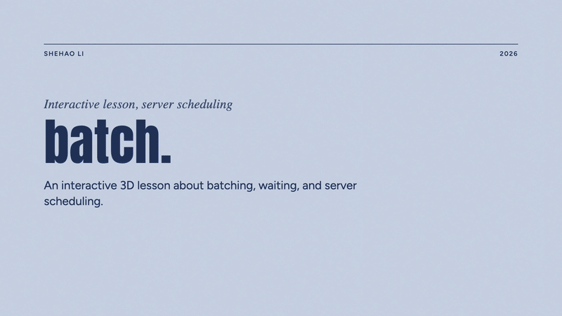

# batch.

An interactive 3D lesson about batching, waiting, and server scheduling.

**Why is my request waiting?**

[Try the lesson](https://lishehao.github.io/batch-lab/)

[](https://lishehao.github.io/batch-lab/)

Follow request A into a server, choose whether to start immediately or wait briefly, and replay the same arrivals with the other strategy. Compare your own completion time with the time needed to finish the entire group.

## What you can try

- Start now or wait briefly for a batch.
- Compare exactly the same requests under both strategies.
- Let all requests arrive at once: a batch need not mean extra waiting.
- Change only the batch limit: one request or up to four together.
- Pause, replay, and expand the model assumptions.

The lesson is free to access and needs no account or API key. It runs in your browser without calling an AI service. WebGL has a text-based fallback, and reduced-motion preferences are supported.

## A transparent teaching model

This is not a benchmark or a reconstruction of OpenAI Fast Mode. The simulation uses four independent, equal-work requests. Each computation round takes `1900 + 300 * batchSize` simulated milliseconds. This illustrative rule makes fixed overhead visible; it is not a measurement of a GPU or language model.

The first experiment fixes a batch limit of four and changes only the deliberate waiting window. The batch-size experiment fixes simultaneous arrivals and no deliberate wait, then changes only the batch limit. The edited question is a label and does not change the workload.

Real language models process inputs and generate outputs over multiple steps. This lesson intentionally abstracts that lifecycle into one round of work and leaves caching and more complex scheduling out of scope.

References: [NVIDIA batching guide](https://docs.nvidia.com/deeplearning/triton-inference-server/user-guide/docs/user_guide/batcher.html), [OpenAI Fast Mode guide](https://developers.openai.com/api/docs/guides/fast-mode), [continuous batching](https://huggingface.co/docs/transformers/continuous_batching_architecture).

## Development

Node.js 22.12 or newer is required. CI uses Node.js 24.

```sh
npm ci
npm run dev
npm run check
npm test
npm run build
```

The production build is static. GitHub Actions tests, builds, and deploys `dist/` to GitHub Pages when `main` changes. The Vite base path is `/batch-lab/`.

The source is available for inspection. No reuse license has been selected for this repository.
